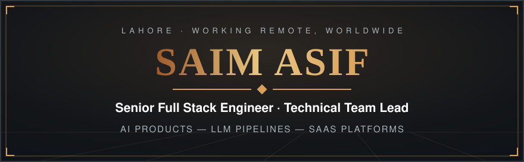
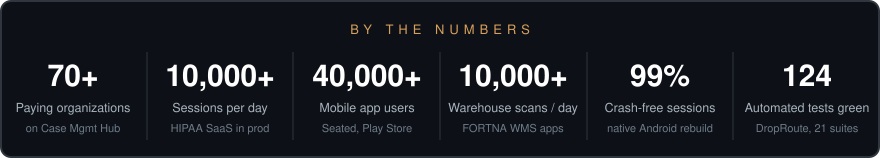
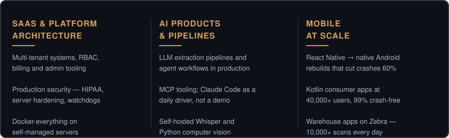
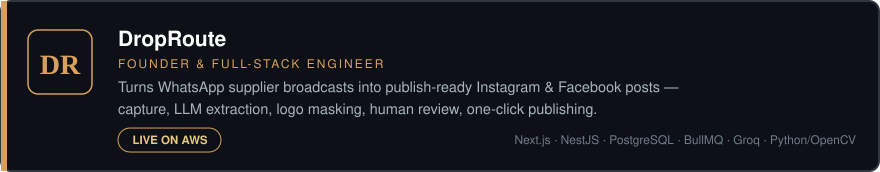
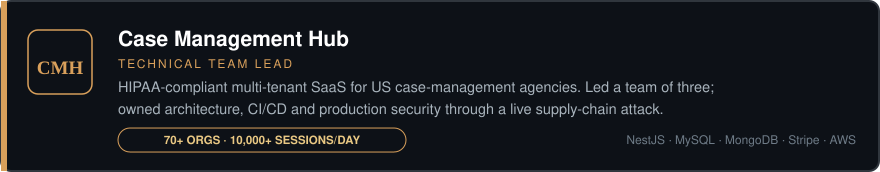
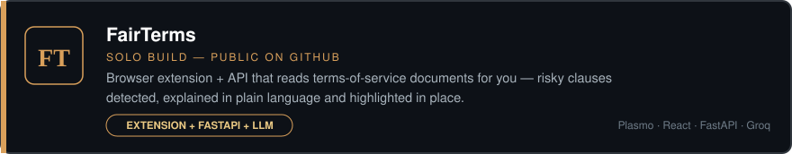
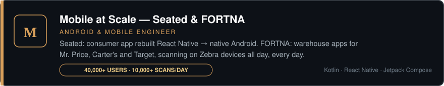
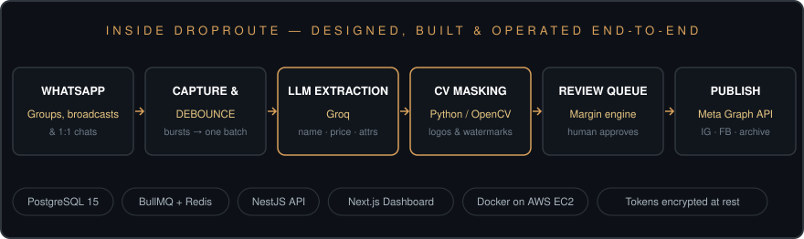
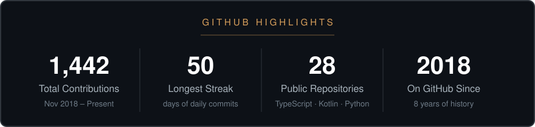

## About

Senior full-stack engineer and technical team lead, building software since 2019. Based in Lahore, working remotely with US and EU teams. I design, build and operate production systems end-to-end — multi-tenant SaaS, AI pipelines and mobile apps — and I still write code every day.

**How I work:** security is a feature, not a phase · ship small, verify live · own the whole stack, from schema to server.

## What I Do

## Featured Work

## System Spotlight

## Tech Stack

## GitHub Stats

