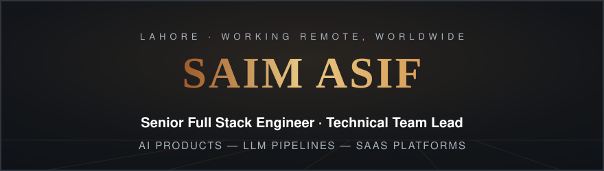

---

## About

Senior full-stack engineer and tech lead (building software since 2019), based in Lahore, Pakistan — working remotely with US and EU teams.

- Led three engineers to build and operate **Case Management Hub**, a HIPAA-compliant healthcare SaaS used by **70+ paying organizations** at 10,000+ sessions a day — architecture, CI/CD, production security.
- Founder of **DropRoute**, a live SaaS that turns WhatsApp supplier broadcasts into publish-ready Instagram/Facebook posts — LLM extraction pipeline plus a Python computer-vision masking layer.
- Shipped mobile at scale: **Seated** (40,000+ users, React Native → native Android rebuild at 99% crash-free) and **FORTNA** warehouse apps for Mr. Price, Carter's and Target (10,000+ scans/day).
- Daily driver: agentic coding tools (Claude Code), MCP-based workflows, and Docker-everything on self-managed servers.

## Tech Stack

## Featured Work

| Project | What it is |
|---|---|
| **[DropRoute](https://droproute.duckdns.org)** | My own SaaS — WhatsApp broadcasts in, publish-ready social posts out. Groq LLM extraction, Python/OpenCV logo masking, BullMQ queues, Meta Graph API publishing. [Code](https://github.com/saaim62/whatsapp-social-bridge) |
| **[Case Management Hub](https://app.casemanagementhub.org)** | HIPAA-compliant multi-tenant SaaS for US case-management agencies — led the team, owned architecture and production. 70+ organizations, Stripe billing, ePHI safeguards. |
| **[FairTerms](https://github.com/saaim62/fairterms)** | Browser extension + FastAPI backend that analyses terms-of-service documents — rule-based detection plus an LLM pass, risk cards and clause highlighting. |
| **[Portfolio](https://saimasif.vercel.app)** | Case studies, live demos and the full project record. |

## GitHub Stats

---

<i>Open to senior full-stack and tech-lead roles — remote, worldwide.</i>

